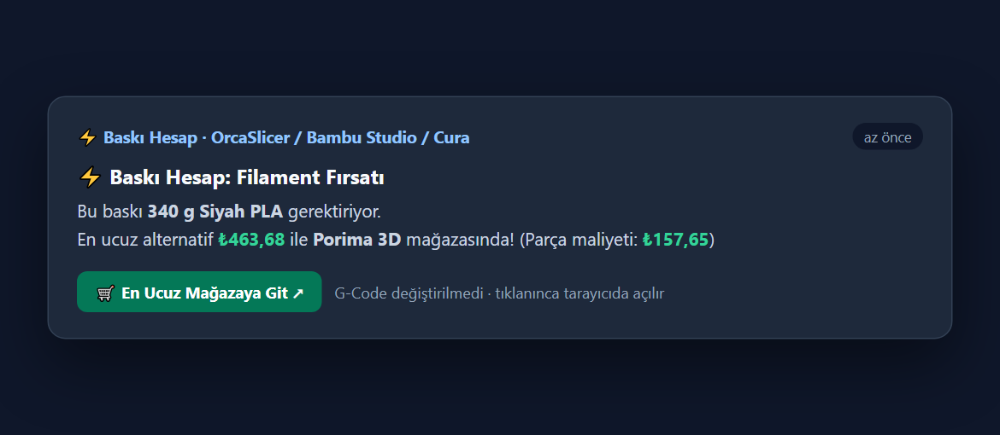
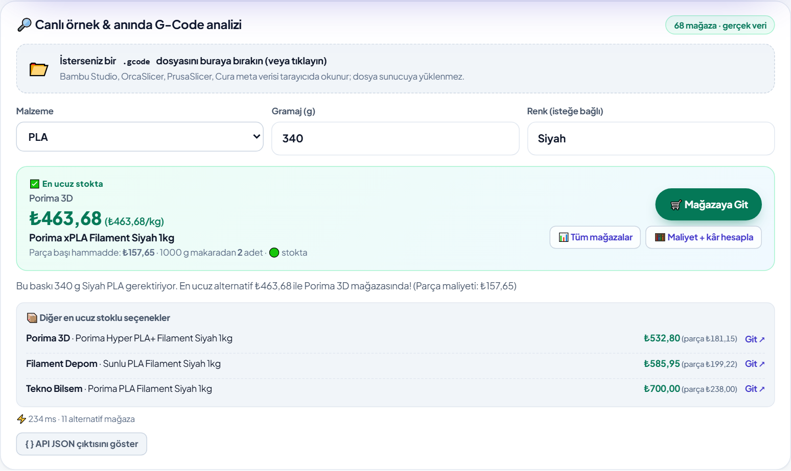

# ⚡ Baskı Hesap — Slicer Eklentisi (Cura · Bambu Studio · OrcaSlicer · PrusaSlicer)

[](LICENSE)
[](https://github.com/erdalkeskin61/baskihesap-slicer-plugin/releases)
[](https://baskihesap.tech/slicer.html)

**Dilimleme bittiği anda harcanacak filamenti hesaplayın ve Türkiye'deki 68 mağazadaki en ucuz stoklu makarayı tek tıkla görün.**  
*(Calculate exact filament usage and find the cheapest in-stock spool across 68 Turkish 3D printing stores right after slicing — zero waiting, zero G-Code modification.)*

- 🌐 **Kurulum Rehberi & Canlı API Testi:** Slicer içi kurulum adımları ve canlı API test ekranı: [baskihesap.tech/slicer.html](https://baskihesap.tech/slicer.html)
- 🧮 **Canlı Web Hesaplayıcı:** Tarayıcıdan STL yükleyip elektrik + fire dahil baskı maliyeti çıkarmak için: [baskihesap.tech/maliyet.html](https://baskihesap.tech/maliyet.html)
- 🗂️ **Güncel Filament Kataloğu:** API'nin taradığı stoklu filament kataloğu: [baskihesap.tech/urunler](https://baskihesap.tech/urunler)

---

## 📸 Önizleme / Preview

| Dilimleme Sonrası Masaüstü Bildirimi | Canlı G-Code Analiz & Teklif Ekranı |
|---|---|
|  |  |

---

## ✨ Özellikler / Features

- **Evrensel Slicer Desteği:**
  - **UltiMaker Cura (4.13+):** Tek dosyayla sürükle-bırak `.curapackage` eklentisi (`cura/EnUcuzNerede.curapackage`).
  - **Bambu Studio, OrcaSlicer, PrusaSlicer:** Harici bağımlılık gerektirmeyen Python 3 post-processing betiği (`src/en_ucuz_slicer.py`).
- **AMS / Çok Renkli G-Code Desteği:** Virgüllü ve noktalı virgüllü çoklu filament ağırlıklarını (`; filament used [g] = 120.5, 45.2`) toplar, baskı süresini (`estimated printing time`) ve renk kodunu okur.
- **Sıfır Gecikme & G-Code Güvenliği:** Dosyayı **yalnızca okur** (asla yazmaz/değiştirmez); ağ sorgusu ve bildirim ayrı süreçte çalışır, dilimlemeyi milisaniyeler içinde serbest bırakır.
- **Tıklanabilir Bildirim:** Windows 10/11 toast bildirimine tıklandığında en ucuz stoklu ürün sayfasını tarayıcıda açar (macOS `osascript` ve Linux `notify-send` destekli).
- **Gizlilik Öncelikli:** Yalnızca malzeme türü (`PLA`, `PETG`, `PLA-CF`, `TPU`…), toplam gramaj ve isteğe bağlı renk gönderilir. Model dosyası veya G-Code içeriği sunucuya gitmez.

---

## 📥 Kurulum / Installation

### 1. UltiMaker Cura (4.13 ve üzeri)

1. `cura/EnUcuzNerede.curapackage` dosyasını indirin (veya [Releases](https://github.com/erdalkeskin61/baskihesap-slicer-plugin/releases) sayfasından alın).
2. Dosyayı açık **Cura** penceresinin üzerine **sürükleyip bırakın**.
3. Cura'yı yeniden başlatın — her dilimleme sonrası sağ alt köşede canlı filament maliyeti ve en ucuz mağaza bağlantısı belirir.

### 2. Bambu Studio · OrcaSlicer · PrusaSlicer

1. `src/en_ucuz_slicer.py` dosyasını bilgisayarınıza kaydedin (ör. `C:\EnUcuz\en_ucuz_slicer.py`).
2. Slicer içinde **Print Settings ➔ Others (veya Output options) ➔ Post-processing scripts** kutusuna şu satırı ekleyin:
   ```text
   python "C:\EnUcuz\en_ucuz_slicer.py"
   ```
   *(macOS / Linux için: `python3 "/opt/baskihesap/en_ucuz_slicer.py"`)*
3. Kurulumu doğrulamak için terminalde çalıştırın:
   ```bash
   python src/en_ucuz_slicer.py --test
   ```

> 💡 Python kurmak istemezseniz tarayıcıdan hiçbir kurulum yapmadan da `.gcode` dosyanızı [baskihesap.tech/slicer.html](https://baskihesap.tech/slicer.html) ekranına sürükleyip aynı sonucu anında alabilirsiniz.

---

## 🔌 Açık API / Public API

Eklenti arka planda herkese açık ve CORS destekli şu ucu kullanır:

```http
GET https://baskihesap.tech/api/embed/oner?malzeme=PLA&gramaj=340&renk=Siyah&kaynak=orca
```

- **Malzeme Ailesi Koruması:** `PLA` aramasında `PLA-CF` veya `PETG` önerilmez; malzeme ailesi sıkı eşleşir.
- **Gerçek Stok Kuralı:** Stokta ürün yoksa sahte fiyat üretilmez (`"status": "bulunamadi"`).
- **Tam Yanıt Alanları:** `enUcuz` (`fiyat`, `tlKg`, `parcaBasiMaliyet`, `yonlendirmeLinki`, `karsilastirmaUrl`), `enIyiAlternatifler` ve `maliyetUrl`.

---

## 📁 Repo Yapısı

```text
baskihesap-slicer-plugin/
├── README.md
├── LICENSE
├── src/
│   └── en_ucuz_slicer.py          # Bambu Studio / OrcaSlicer / PrusaSlicer betiği
├── cura/
│   ├── EnUcuzNerede.curapackage   # Hazır Cura paketi (v1.0.0)
│   └── EnUcuzNerede/              # Cura eklenti kaynak kodları
└── docs/
    └── screenshots/               # Bildirim ve canlı arayüz önizlemeleri
```

---

## 📄 Lisans

MIT © 2026 [Baskı Hesap](https://baskihesap.tech/)
